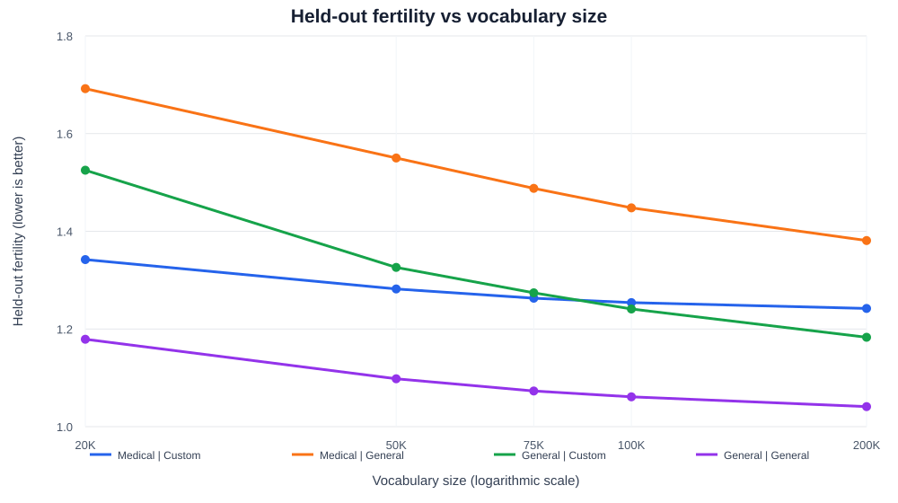

# Domain-Specific Tokenizer: Evaluation and Vocabulary-Size Selection

> **Current recommendation:** use **50K as the balanced starting point** for a tokenizer intended to handle both medical and general text. If the tokenizer is primarily for medical text, **75K is a defensible alternative** based on the medical held-out knee. This is a tokenizer-efficiency recommendation, not proof of downstream language-model quality.

## Contents

- [Why build a custom tokenizer?](#why-build-a-custom-tokenizer)
- [What the experiments show](#what-the-experiments-show)
- [How the evaluation was performed](#how-the-evaluation-was-performed)
- [Choosing vocabulary size](#choosing-vocabulary-size)
  - [1. Corpus-derived rule](#1-corpus-derived-rule)
  - [2. Knee-point method](#2-knee-point-method)
- [Why vocabulary size matters](#why-vocabulary-size-matters)
- [Limitations and next experiments](#limitations-and-next-experiments)
- [Reproduce and explore](#reproduce-and-explore)

## Why build a custom tokenizer?

A tokenizer converts text into token IDs that a language model can process. The tokenizer's vocabulary determines which character sequences, word fragments, whole words, and symbols can be represented as individual tokens.

A general-purpose tokenizer is trained to represent a broad mixture of language and domains. That is useful for broad coverage, but it may not allocate enough vocabulary capacity to specialized terminology. Medical text contains domain-specific terms, abbreviations, drug names, clinical expressions, morphology, and combinations of prefixes and suffixes. A general tokenizer may split one medical term into several smaller pieces.

For example, a domain tokenizer may learn a frequent medical term as one token or a small number of meaningful subword units, while a general tokenizer may split it into many fragments. The exact segmentation depends on the tokenizer algorithm and its learned vocabulary; the example is illustrative, not a claim about a particular word in this experiment.

A custom tokenizer can therefore:

1. **Represent domain terminology more compactly.** Frequent medical terms and recurring subword patterns can receive vocabulary entries.
2. **Reduce sequence length on the target domain.** Fewer tokens for the same text can reduce the number of positions processed by the Transformer.
3. **Use the vocabulary budget more deliberately.** Vocabulary entries can reflect the frequency distribution of the target corpus rather than only broad web/general-language statistics.
4. **Improve consistency of segmentation.** Related medical terms may be represented using reusable subword patterns.
5. **Make domain adaptation measurable.** Fertility provides a direct, tokenizer-level measure of how efficiently a tokenizer segments a corpus.

A custom tokenizer is not automatically better in every domain. A tokenizer optimized for medical text can be less efficient on general text if its vocabulary capacity is spent on medical terms that are rare in general language. Your results show exactly this trade-off.

## What the experiments show

The experiments compare two tokenizer configurations:

- **Custom tokenizer:** trained/constructed using the medical-domain corpus.
- **General tokenizer:** the general-purpose tokenizer used as the baseline.

Both are evaluated on two text distributions:

- **Medical data**
- **General data**

The comparison is repeated at five vocabulary sizes: **20K, 50K, 75K, 100K, and 200K**.

### Held-out results: primary comparison

Held-out fertility is the primary metric for selecting vocabulary size because it measures segmentation on data not used to fit the tokenizer.

| Vocabulary | Medical: custom | Medical: general | General: custom | General: general |
|---:|---:|---:|---:|---:|
| 20K | 1.342 | 1.692 | 1.525 | 1.179 |
| 50K | 1.282 | 1.550 | 1.326 | 1.098 |
| 75K | 1.263 | 1.488 | 1.274 | 1.073 |
| 100K | 1.254 | 1.448 | 1.241 | 1.061 |
| 200K | 1.242 | 1.381 | 1.183 | 1.041 |

**Interpretation:**

- On held-out **medical data**, the custom tokenizer has lower fertility than the general tokenizer at every tested vocabulary size.
- On held-out **general data**, the general tokenizer has lower fertility than the medical custom tokenizer at every tested vocabulary size.
- This is evidence of domain specialization: the custom tokenizer is more efficient on medical text, while the general tokenizer remains more efficient on general text.
- Increasing vocabulary size reduces fertility for both tokenizers, but the improvement becomes smaller as vocabulary grows.

At 50K, for example:

- Medical held-out fertility falls from **1.550** with the general tokenizer to **1.282** with the custom tokenizer. This is approximately **17.3% lower fertility** relative to the general-tokenizer baseline.
- General held-out fertility is **1.326** with the custom tokenizer versus **1.098** with the general tokenizer. The custom tokenizer is approximately **20.8% higher fertility** relative to the general-tokenizer baseline.

The medical advantage is meaningful, but it comes with a general-language trade-off. If the intended model is medical-only, that trade-off may be acceptable. If the model must serve both domains, the vocabulary-size decision should consider both held-out distributions.

### Train results: supporting comparison

| Vocabulary | Medical: custom | Medical: general | General: custom | General: general |
|---:|---:|---:|---:|---:|
| 20K | 2.250 | 2.809 | 1.612 | 1.403 |
| 50K | 2.015 | 2.559 | 1.419 | 1.273 |
| 75K | 1.956 | 2.456 | 1.358 | 1.247 |
| 100K | 1.868 | 2.309 | 1.323 | 1.241 |
| 200K | 1.779 | 2.132 | 1.250 | 1.220 |

The train results show a similar domain pattern. However, training fertility alone is not sufficient to select a vocabulary size: a tokenizer can fit training text well without generalizing equally well to unseen text. That is why the held-out results drive the knee analysis below.

### Visual comparison



## How the evaluation was performed

### 1. Fertility

In tokenizer evaluation, **fertility** is commonly used to describe how many tokens are produced per word. For this experiment, interpret the reported fertility values according to the exact calculation used in your evaluation script. A common definition is:

$$
\text{Fertility} = \frac{\text{Number of tokens}}{\text{Number of words}}
$$

Under this definition:

- Lower fertility means fewer tokens are needed to represent the same number of words.
- Higher fertility means the tokenizer splits words into more pieces on average.
- Fertility is a segmentation-efficiency metric; it does not directly measure semantic understanding or language-model accuracy.

**Important reproducibility note:** retain the same fertility implementation, word-counting convention, normalization, and treatment of punctuation/special tokens across all runs. If your code uses a different denominator or definition, document that exact definition here instead of assuming the formula above.

### 2. Train and held-out split

The results are reported separately for:

- **Train:** text used when fitting/training the tokenizer.
- **Held-out:** separate text not used to fit the tokenizer.

This separation matters because a tokenizer can memorize frequent training patterns. Held-out fertility gives a better indication of whether its segmentation efficiency transfers to unseen examples from the same target distribution.

The medical and general held-out corpora should also be kept separate. Combining them into one number too early can hide the fact that the custom and general tokenizers have different strengths.

### 3. Controlled vocabulary-size comparison

The same five vocabulary-size settings were evaluated for both tokenizer configurations. This makes it possible to compare the effect of vocabulary size without relying on a single setting.

For a fully reproducible benchmark, record the following alongside the results:

- Tokenizer algorithm and implementation/version (for example, BPE, WordPiece, or Unigram).
- Exact tokenizer training corpus and corpus version.
- Train/held-out split method and document-level separation.
- Text cleaning and normalization rules.
- Special-token inventory and whether special tokens count toward the stated vocabulary size.
- Minimum token frequency / minimum pair frequency, if applicable.
- Exact fertility calculation and evaluation script version.
- Random seed and any tokenizer-training parameters.

### 4. What the evaluation establishes—and what it does not

The results establish that the custom tokenizer segments the held-out medical corpus more compactly than the general tokenizer at the tested vocabulary sizes.

They do **not**, by themselves, establish that a language model trained with the custom tokenizer will have lower validation loss, better clinical QA, better entity extraction, or better factual accuracy. Those are downstream model outcomes and need separate experiments.

A useful next-stage experiment is to train comparable small language models using the candidate tokenizers, keeping model architecture, training data, compute budget, and training procedure as controlled as possible. Compare validation loss/perplexity carefully, and evaluate task-level performance on representative medical benchmarks.

## Choosing vocabulary size

There is no universally optimal vocabulary size. It depends on the amount of training text, its domain diversity, the tokenizer algorithm, the model's embedding dimension, the compute/memory budget, and the downstream task.

Use two complementary approaches:

1. A **corpus-derived rule** to establish a sensible range based on the amount and frequency distribution of text available.
2. A **knee-point method** to identify where increasing vocabulary size starts giving diminishing returns in the measured fertility curve.

These methods answer different questions. The corpus-derived rule asks, "Can my corpus support this many vocabulary entries?" The knee method asks, "At what vocabulary size does the measured benefit begin to flatten?"

### 1. Corpus-derived rule

There is no single universally accepted mathematical law that maps corpus size directly to an ideal tokenizer vocabulary. A practical corpus-derived rule should use the corpus's actual token-frequency distribution rather than selecting a vocabulary size from corpus size alone.

A useful procedure is:

**Step A — Count the training corpus.**

Let:

- \(N\) = number of words or pre-tokenized units in the tokenizer-training corpus (choose one unit and use it consistently).
- \(f(t)\) = frequency of candidate token/subword \(t\).
- \(V\) = candidate vocabulary size.

**Step B — Build the frequency-ranked candidate list.**

Count candidate words/subwords using the same normalization and pre-tokenization rules that will be used for tokenizer training. Sort candidates by frequency.

**Step C — Measure cumulative frequency coverage.**

For the top \(V\) candidates, calculate:

$$
\text{Coverage}(V) =
\frac{\sum_{t \in \text{Top-}V} f(t)}{N}
$$

This estimates the fraction of corpus units covered by the selected candidates. The exact interpretation depends on how candidates are defined; for BPE, learned merges and fallback character/subword units mean this is a screening statistic, not a complete simulation of tokenization.

**Step D — Apply a support threshold.**

Check how many candidate entries occur only a handful of times. A large vocabulary full of extremely rare entries can consume embedding parameters while contributing little to typical text. You can choose a minimum frequency threshold based on the size and diversity of your corpus, then inspect how many entries survive it.

A simple support constraint is:

$$
V_{\text{supported}} =
\left|\{t : f(t) \geq f_{\min}\}\right|
$$

where \(f_{\min}\) is a chosen minimum occurrence count. This is a practical filtering heuristic, not a universal constant.

**Step E — Use corpus statistics to shortlist sizes.**

Shortlist vocabulary sizes that:
- achieve good cumulative frequency coverage,
- do not allocate a large fraction of entries to extremely rare candidates,
- retain useful domain-specific terms,
- and leave enough examples for the tokenizer to learn robust subword patterns.

Then evaluate those shortlisted sizes on held-out fertility, as done in this project.

**What can be concluded from the current results?**

The supplied experiment table does not include the total number of tokenizer-training words/tokens, the unique candidate count, or the candidate frequency distribution. Therefore, the corpus-derived rule cannot be assigned a defensible numeric winner from this table alone.

To complete this part, calculate and save:
- total training corpus words/tokens,
- number of unique candidate units,
- frequency histogram,
- number of candidates above selected minimum-frequency thresholds,
- cumulative frequency coverage for the candidate vocabulary sizes.

Do not present a corpus-rule result as measured until those corpus statistics have been computed. The 50K recommendation below is based on the held-out knee analysis, not on an unavailable corpus-size calculation.

### 2. Knee-point method

The knee (or elbow) method identifies a point on a curve where additional resources—in this case, vocabulary entries—produce progressively smaller gains.

It is a geometric heuristic, not a formal theorem guaranteeing the optimal vocabulary size. Its result depends on the selected metric, normalization, x-axis scale, endpoints, and distance definition. These choices should be stated explicitly.

For this experiment:

- X-axis: vocabulary size, log-scaled.
- Y-axis: held-out fertility, min-max normalized separately for each corpus.
- Lower raw fertility is better.
- The selected knee is the interior point with the largest perpendicular distance from the straight line joining the two endpoint observations.

#### Step 1 — Normalize vocabulary size

For vocabulary size \(V_i\), use:

$$
x_i =
\frac{\log_{10}(V_i)-\log_{10}(20K)}
{\log_{10}(200K)-\log_{10}(20K)}
$$

The normalized x-coordinates are:

| Vocabulary | Normalized \(x\) |
|---:|---:|
| 20K | 0.0000 |
| 50K | 0.3979 |
| 75K | 0.5740 |
| 100K | 0.6990 |
| 200K | 1.0000 |

A logarithmic axis is appropriate here because the tested vocabulary sizes span a tenfold range. It treats proportional changes in vocabulary size more evenly than a linear axis.

#### Step 2 — Normalize held-out fertility

For each held-out curve independently:

$$
y_i = \frac{F_i-F_{\min}}{F_{\max}-F_{\min}}
$$

where \(F_i\) is the raw fertility at vocabulary size \(V_i\).

This maps the highest observed fertility to 1 and the lowest to 0. The endpoints become:

- 20K: \((x,y)=(0,1)\)
- 200K: \((x,y)=(1,0)\)

#### Step 3 — Calculate distance from the endpoint chord

The straight line joining those normalized endpoints is:

$$
x+y=1
$$

The perpendicular distance of each point from that line is:

$$
D_i = \frac{|x_i+y_i-1|}{\sqrt{2}}
$$

The endpoints have distance zero by construction. Select the interior vocabulary size with the largest distance.

#### Step 4 — Medical held-out calculation

Custom-tokenizer medical held-out fertility:

$$
[1.342,\ 1.282,\ 1.263,\ 1.254,\ 1.242]
$$
The minimum is 1.242 and maximum is 1.342. Therefore:

$$
y = [1.0000,\ 0.4000,\ 0.2100,\ 0.1200,\ 0.0000]
$$

| Vocabulary | \(x\) | \(y\) | Distance \(D\) |
|---:|---:|---:|---:|
| 20K | 0.0000 | 1.0000 | 0.0000 |
| 50K | 0.3979 | 0.4000 | 0.1429 |
| 75K | 0.5740 | 0.2100 | **0.1527** |
| 100K | 0.6990 | 0.1200 | 0.1280 |
| 200K | 1.0000 | 0.0000 | 0.0000 |

**Medical held-out knee: 75K.**

#### Step 5 — General held-out calculation

Custom-tokenizer general held-out fertility:

$$
[1.525,\ 1.326,\ 1.274,\ 1.241,\ 1.183]
$$

The minimum is 1.183 and maximum is 1.525. The normalized values are approximately:

$$
y = [1.0000,\ 0.4181,\ 0.2661,\ 0.1696,\ 0.0000]
$$

| Vocabulary | \(x\) | \(y\) | Distance \(D\) |
|---:|---:|---:|---:|
| 20K | 0.0000 | 1.0000 | 0.0000 |
| 50K | 0.3979 | 0.4181 | **0.1301** |
| 75K | 0.5740 | 0.2661 | 0.1131 |
| 100K | 0.6990 | 0.1696 | 0.0929 |
| 200K | 1.0000 | 0.0000 | 0.0000 |

**General held-out knee: 50K.**

#### Step 6 — Select one vocabulary size for both domains

If the tokenizer must serve both medical and general text, give the two held-out datasets equal weight. Average their normalized distance values at each vocabulary size:

$$
D_{\text{combined}}(V_i) =
\frac{D_{\text{medical}}(V_i)+D_{\text{general}}(V_i)}{2}
$$

| Vocabulary | Medical distance | General distance | Mean distance |
|---:|---:|---:|---:|
| 20K | 0.0000 | 0.0000 | 0.0000 |
| 50K | 0.1429 | 0.1301 | **0.1365** |
| 75K | 0.1527 | 0.1131 | 0.1329 |
| 100K | 0.1280 | 0.0929 | 0.1105 |
| 200K | 0.0000 | 0.0000 | 0.0000 |

The highest equal-weight mean distance is at **50K**.

This gives the following interpretation:

- **50K:** best balanced knee across the two held-out domains.
- **75K:** best knee for medical held-out data alone.
- **100K–200K:** lower raw fertility continues, but the geometric knee analysis indicates weaker marginal benefit relative to vocabulary growth.

The combined result depends on the equal weighting of medical and general data. If the real application is, for example, 90% medical and 10% general, use those deployment proportions as weights and recompute the combined curve. Do not assume equal weights if they do not represent the expected workload.

## Why vocabulary size matters

Vocabulary size is an architectural and resource decision, not merely a tokenizer setting.

### 1. Embedding parameter count

For a model dimension \(d_{\text{model}}\), the input embedding matrix contains:

$$
P_{\text{embedding}} = V \times d_{\text{model}}
$$

For a model with \(d_{\text{model}}=768\):

| Vocabulary | Input embedding parameters |
|---:|---:|
| 20K | 15.36 million |
| 50K | 38.40 million |
| 75K | 57.60 million |
| 100K | 76.80 million |
| 200K | 153.60 million |

This counts the input embedding matrix only. If the model uses an untied output projection, that projection can add another vocabulary-dependent matrix. If input and output embeddings are tied, the parameter accounting differs.

A jump from 50K to 200K adds **115.2 million input-embedding parameters** at dimension 768. That is a substantial cost and should be justified by measurable gains.

### 2. Sequence length and attention cost

A tokenizer that produces fewer tokens for the same text can reduce sequence length. This can be valuable because standard full self-attention has a sequence-length-dependent computation and memory cost that grows approximately quadratically with sequence length:

$$
O(L^2)
$$

where \(L\) is the number of tokens in the sequence.

Lower fertility can therefore improve the amount of text represented in a fixed context window and may reduce attention cost. Actual end-to-end savings depend on batching, padding, architecture, and hardware.

### 3. Rare-token and data sparsity trade-off

A very large vocabulary can create many low-frequency entries. Those entries may receive relatively few training examples, making their embeddings harder to estimate reliably.

A smaller vocabulary encourages more sharing through subword units, but can split domain-specific terms into many fragments. The goal is a balance:

- Too small: excessive fragmentation and longer sequences.
- Too large: larger embedding/output matrices and potentially sparse vocabulary entries.
- Appropriate size: enough domain coverage without paying heavily for marginal segmentation gains.

### 4. Deployment and compatibility

The tokenizer vocabulary is part of the model's input/output interface. Changing it after training changes token IDs and embedding semantics. A model checkpoint and its tokenizer must remain paired. Vocabulary size should therefore be selected before substantial model training, or changes should be treated as a deliberate model migration.

## Limitations and next experiments

This experiment is a useful tokenizer-level benchmark, but several additions would make the conclusion stronger:

1. **Corpus statistics:** publish corpus token/word counts, unique candidate counts, and frequency distributions so the corpus-derived shortlist can be calculated.
2. **More vocabulary points:** test around the observed knees, for example 40K, 45K, 50K, 55K, 60K, 65K, 70K, and 75K. Five points provide only a coarse estimate of the knee.
3. **Multiple held-out samples:** evaluate more than one held-out split and report mean and variation.
4. **Domain mixture:** evaluate a held-out mixture that reflects the expected production workload, not only an equal-weight average.
5. **Downstream language-model tests:** train comparable models and compare validation loss/perplexity, task metrics, and generation quality.
6. **Operational metrics:** measure actual tokens per document, context-window utilization, throughput, memory, and latency.
7. **Tokenizer consistency:** confirm that normalization, special-token handling, and fertility implementation are identical across runs.

## Reproduce and explore

The repository should contain:

```text
.
├── README.md
├── tokenizer_vocab_analysis.html
└── tokenizer_heldout_fertility.svg
```

- **Interactive graph:** open [`tokenizer_vocab_analysis.html`](./tokenizer_vocab_analysis.html) locally in a browser. It includes all eight train/held-out curves, dataset selection, raw results, and knee calculations.
- **Static graph:** [`tokenizer_heldout_fertility.svg`](./tokenizer_heldout_fertility.svg) is embedded above and renders directly in GitHub's README.

> GitHub sanitizes active JavaScript in README Markdown, so an interactive HTML page cannot execute *inside* the README itself. The README therefore embeds a static SVG preview and links to the standalone interactive HTML. To host the interactive version on GitHub Pages, publish the HTML file from the repository and link to its Pages URL.

## Final conclusion

The experiments show that a medical-domain custom tokenizer substantially improves held-out medical segmentation efficiency compared with the general tokenizer, but it does not outperform the general tokenizer on general-language data.

The held-out knee analysis gives:

- Medical-specific knee: **75K**
- General held-out knee for the custom tokenizer: **50K**
- Equal-weight combined knee: **50K**

Therefore, **50K is the most defensible balanced starting vocabulary size from the current experiment**. Use 75K if the tokenizer is specifically intended for medical text and the additional vocabulary cost is acceptable. Confirm the corpus-derived shortlist once the corpus frequency statistics are available, then validate the final choice with downstream language-model training.
